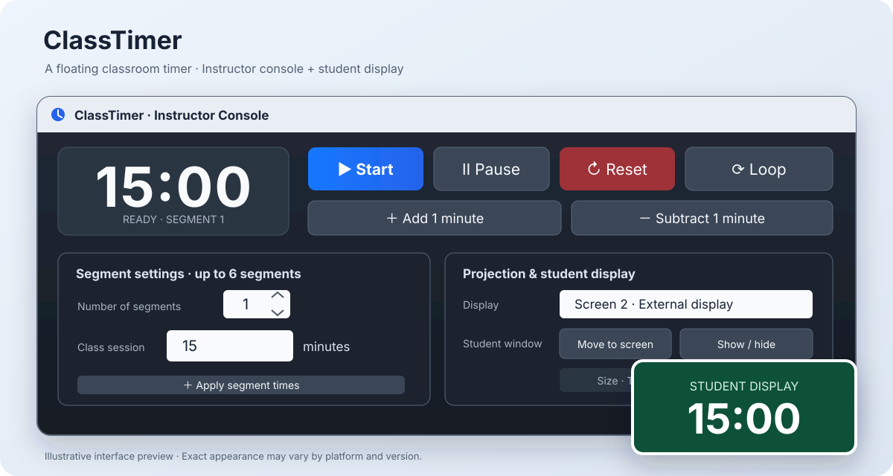
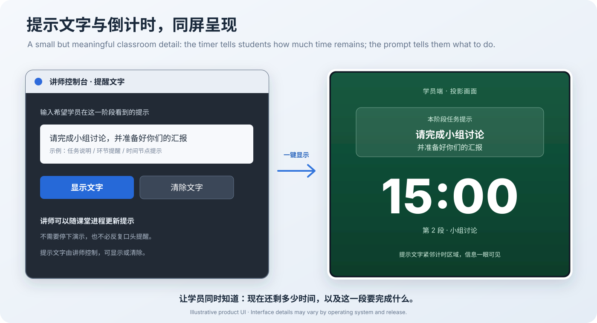

# ClassTimer

**A floating classroom timer with on-screen task prompts for Windows and macOS**  
**面向课堂、培训、工作坊与演讲的悬浮计时器**

讲师在自己的屏幕上控制计时；除了倒计时，讲师还可以把任务要求、环节提醒等提示文字直接显示在学员端投影画面上，让学员同时看见「还剩多少时间」和「这一段要做什么」。

### 核心特色：提示文字直接显示在计时画面

讲师在控制台输入提示文字，点击「显示文字」，学员端便会在倒计时上方看到相应内容。它可以用来呈现小组讨论任务、阶段目标、汇报提醒或下一环节说明。时间和任务要求在同一画面里，减少讲师反复口头提醒，也让学员更容易跟上课堂节奏。

[Windows 下载](https://github.com/jeffreyliutime/ClassTimer/releases/download/WindowsV1.7/ClassTimerLite_Windows_v1.7.zip) · [macOS 下载](https://github.com/jeffreyliutime/ClassTimer/releases/download/MacV1.2/ClassTimer-For-Mac.rar) · [问题与反馈](https://github.com/jeffreyliutime/ClassTimer/issues)

---

## What it does｜它解决什么问题

ClassTimer separates the instructor's controls from the timer shown to the audience.

- **Instructor console｜讲师控制台**：设置计时段、开始／暂停／重置、调整时间与控制显示窗口。
- **Floating student display｜学员悬浮窗**：独立显示计时数字，可用于投影、扩展屏和课堂大屏；提示文字与计时同屏呈现。
- **Multi-segment timing｜多段计时**：最多六段，每段独立设置时长。
- **Flexible modes｜多种模式**：倒计时、正计时与当前时钟。
- **On-screen prompts｜提示文字上屏**：讲师可随时输入、显示或清除提示文字，将任务要求和环节提醒放在学员端倒计时上方。\n- **Presentation-friendly｜适合演示场景**：可选择显示屏、调整窗口尺寸、切换背景主题。

## Downloads｜下载

| Platform | Version | Download | Compatibility |
|---|---|---|---|
| Windows | **ClassTimer Lite 1.7** | [ZIP · 19 KB](https://github.com/jeffreyliutime/ClassTimer/releases/download/WindowsV1.7/ClassTimerLite_Windows_v1.7.zip) | Windows 10 / 11 · .NET Framework 4.8 |
| macOS | **ClassTimer 1.2** | [RAR · 841 KB](https://github.com/jeffreyliutime/ClassTimer/releases/download/MacV1.2/ClassTimer-For-Mac.rar) | Apple Silicon (M1 and later) · macOS 27.0+ |

You can also find both packages on the [Releases page](https://github.com/jeffreyliutime/ClassTimer/releases).

## Windows｜安装与使用

1. Download [ClassTimer Lite v1.7](https://github.com/jeffreyliutime/ClassTimer/releases/download/WindowsV1.7/ClassTimerLite_Windows_v1.7.zip).
2. Extract the ZIP file.
3. Double-click `ClassTimerLite.exe`.
4. Set the number and duration of segments, select the display, then start the timer.

**Runtime:** .NET Framework 4.8. The package does not include Chromium and does not require an installer.

**Windows security notice:** The current package is not signed with a publicly trusted code-signing certificate. Windows SmartScreen may therefore show an unfamiliar-publisher warning. This warning does not by itself mean malware has been detected. Download only from a source you trust; do not disable Windows security protections to run the app.

## macOS｜安装与使用

The macOS v1.2 build targets Apple Silicon and macOS 27.0 or later.

1. Download [ClassTimer for Mac v1.2](https://github.com/jeffreyliutime/ClassTimer/releases/download/MacV1.2/ClassTimer-For-Mac.rar).
2. Extract the RAR archive with an archive utility.
3. Move `ClassTimer.app` into the Applications folder.
4. Open ClassTimer and configure the instructor and student windows.

**macOS security notice:** The current build has not been signed with an Apple Developer ID certificate or notarized by Apple. macOS may show a first-launch security prompt. Verify the download source and use macOS's normal per-app approval process if appropriate. Do not disable Gatekeeper.

## Signature feature｜提示文字与倒计时同屏

Most timers only answer one question: **How much time is left?** ClassTimer also lets the instructor show a second piece of information directly on the student display: **What should we be doing during this time?**

- Enter a task prompt or reminder in the instructor console.
- Click **显示文字** to show it on the student / projection window, above the countdown.
- Update or clear the prompt as the class moves to the next segment.

Examples include “请完成小组讨论并准备汇报”, “接下来进入案例分析” and “请准备提问”。

## Features｜功能清单

- Up to 6 timer segments｜最多六段计时
- Per-segment hours, minutes and seconds｜每段独立设置时、分、秒
- Countdown / count-up / clock｜倒计时、正计时、时钟
- Start, pause, resume and reset｜开始、暂停、继续、重置
- Quick adjustment by one minute｜加减一分钟
- Optional loop mode｜循环计时
- Selectable display screen｜选择投影／显示屏
- Floating student window with size and theme options｜学员悬浮窗尺寸与主题设置
- On-screen reminder / task prompts above the countdown｜在倒计时上方显示提醒文字、任务要求和环节指令

Features and window behavior can differ slightly by operating system.

## Privacy｜隐私

The macOS app does not require an account or login and is designed to run locally. It does not request camera, microphone, screen-recording or accessibility permissions for its timer display. The Windows app also runs as a local desktop utility.

## Repository status｜仓库状态

This repository contains the project overview, interface preview and downloadable Windows and macOS release packages. The complete, reproducible source projects for the current Windows and macOS releases have not yet been published here.

The project license has not yet been specified. Until a license is added, no open-source reuse or redistribution rights should be assumed.

## Feedback

Please use [GitHub Issues](https://github.com/jeffreyliutime/ClassTimer/issues) for bug reports and feature suggestions.
